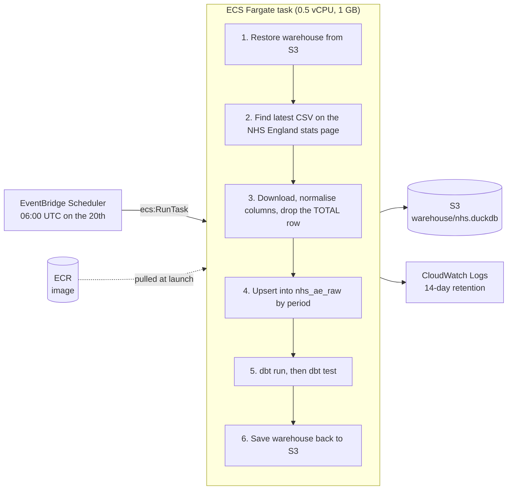
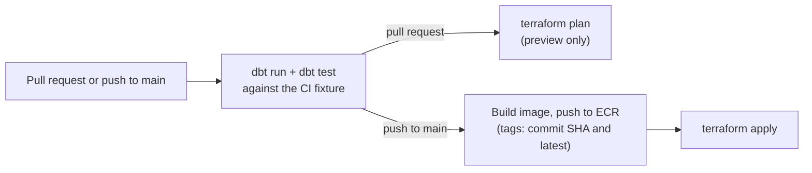
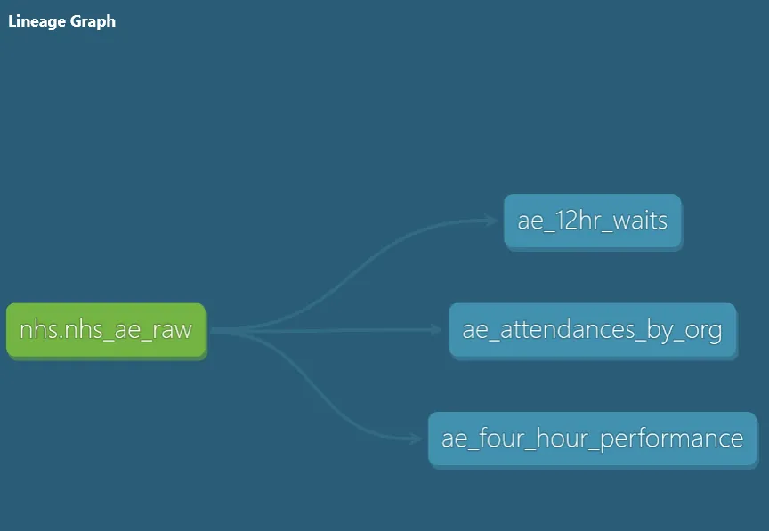
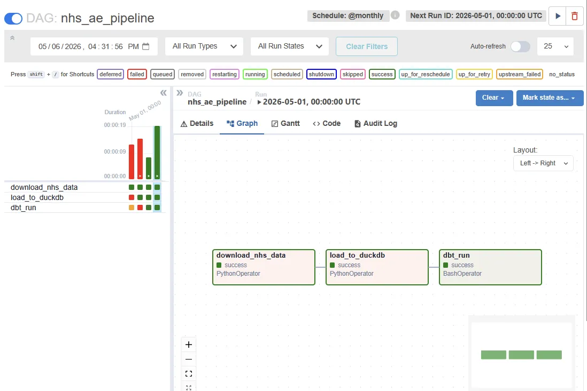

# NHS A&E Analytics Pipeline

[](https://github.com/mo-mo35/NHS-Airflow-dbt-Pipeline/actions/workflows/deploy.yml)

A monthly batch pipeline that finds the latest NHS England A&E waiting-times release, upserts it into a DuckDB warehouse and builds dbt models for attendances, 4-hour performance and 12-hour waits by provider. It runs on AWS ECS Fargate on a schedule, all infrastructure is defined in Terraform, and GitHub Actions deploys it using OIDC, so no AWS keys are stored anywhere.

| | |
|---|---|
| **Schedule** | 06:00 UTC on the 20th of each month, via EventBridge Scheduler |
| **Compute** | ECS Fargate, 0.5 vCPU / 1 GB, `eu-west-2` |
| **Data volume** | ~200 provider rows per monthly release |
| **Warehouse** | DuckDB file, restored from and saved to S3 on every run |
| **Transformations** | 3 dbt models, 6 dbt tests |
| **Infrastructure** | Terraform, with remote state in S3 and native locking |
| **CI/CD** | GitHub Actions: dbt tests on every push and PR, `terraform plan` on PRs, image build and `terraform apply` on merge to `main` |
| **Cost** | A few cents a month, with a $2/month budget alert and 14-day log retention |

## Architecture

### Runtime



### CI/CD



GitHub's OIDC token is exchanged for short-lived AWS credentials. The IAM role's trust policy only accepts tokens issued for this repository, and image pushes and `terraform apply` only run on merges to `main`.

## What it does

1. **Finds the latest release.** NHS England's CSV URL changes every month and can't be computed from a date, so the task reads the current fiscal-year statistics page (falling back to the previous year early in April) and takes the newest "Monthly A&E ... (CSV)" link.
2. **Loads it idempotently.** Column names are normalised, the England-wide `TOTAL` row is dropped, and the load deletes and re-inserts only the periods present in the new file. Re-running a month is safe, and history builds up across monthly runs.
3. **Transforms it with dbt.** Three models, built as views over `nhs_ae_raw`:

| Model | What it calculates |
|---|---|
| `ae_attendances_by_org` | Attendances by provider, split into Type 1, Type 2 and other A&E departments, plus the total |
| `ae_four_hour_performance` | Share of Type 1 attendances seen within 4 hours: 100 × (1 − attendances over 4 hours ÷ Type 1 attendances) |
| `ae_12hr_waits` | Patients waiting 12+ hours from decision to admit to admission, as a share of Type 1 attendances |

4. **Fails loudly.** If `dbt run` or `dbt test` fails, the process exits non-zero, so the ECS task is marked failed instead of finishing green.
5. **Persists the warehouse.** Fargate has no disk between runs, so the DuckDB file is restored from S3 at the start and written back at the end.

### Data quality

Six dbt tests: five `not_null` checks on provider codes and key metrics, plus a singular test that fails if the England-wide `TOTAL` row ever reappears in the raw table. That row was found on the first live run (1 October 2026), and it is now filtered at load time and guarded by this test.

### dbt lineage



## Design decisions

- **One scheduled container instead of always-on Airflow.** The first version ran in Airflow on Docker Compose. For a job that runs once a month, a permanent scheduler is the wrong tool, so the cloud version is a single container started by EventBridge Scheduler and billed only while it runs. Airflow stays in the repo for local development.
- **Sized for the data.** A 0.5 vCPU / 1 GB task is plenty for ~200 rows of pandas and DuckDB work.
- **No NAT gateway.** The task only makes outbound calls (NHS England, ECR, S3, CloudWatch), so it runs in the default VPC with a public IP and an outbound-only security group rather than paying for a NAT gateway.
- **Scoped runtime permissions.** The task role can only read and write the project's S3 bucket, and the scheduler role can only run this task definition.
- **Tests that don't depend on the internet.** CI pushes a checked-in fixture (`tests/fixtures/sample_ae_data.csv`) through the same load and dbt code that production uses, so a build never depends on NHS England's website being up.

## Known trade-offs

- One IAM role is shared by PR and `main` jobs, and its permissions are broad (`ecs:*`, `s3:*` and others) so that `terraform apply` can manage everything. A team setup would split a read-only plan role from an apply role.
- The warehouse is a single DuckDB file in S3. That suits one monthly writer, not concurrent runs.
- Each run loads only the latest published month, so history starts at the first run and grows monthly. There is no backfill.
- A failed run shows up as a failed ECS task and in CloudWatch Logs, but nothing alerts on it yet.
- The `latest` image tag is mutable, and ECR and S3 are created with `force_delete` / `force_destroy`. That suits a portfolio project, not production.

## Run it

### Run the tests (no AWS needed)

```bash
python -m venv .venv && source .venv/bin/activate
pip install -r requirements.txt
python scripts/ci_test.py
```

This loads the 3-row fixture into DuckDB, then runs `dbt run` (3 models) and `dbt test` (6 tests). To browse the lineage graph afterwards:

```bash
cd dbt/nhs_dbt
dbt docs generate --profiles-dir ../../data/dbt_profiles
dbt docs serve --profiles-dir ../../data/dbt_profiles --port 8081
```

### Query the deployed warehouse

```bash
aws s3 cp s3://nhs-ae-pipeline-<aws-account-id>/warehouse/nhs.duckdb .
duckdb nhs.duckdb "select * from ae_four_hour_performance limit 10;"
```

### Run locally with Airflow (the original version)

Docker Compose starts Airflow 2.9 with Postgres. The `nhs_ae_pipeline` DAG chains three tasks: download the CSV, load it into DuckDB, then run `dbt run` and `dbt test`.



```bash
docker compose up airflow-init
docker compose up -d
```

Open http://localhost:8080 (user `admin`, password `admin`, local only) and trigger `nhs_ae_pipeline`. This DAG is the first prototype: it hard-codes the CSV URL (`NHS_CSV_URL` in `dags/nhs_ae_pipeline.py`, so update it from the [NHS England page](https://www.england.nhs.uk/statistics/statistical-work-areas/ae-waiting-times-and-activity/)) and recreates the table on every run. `run_pipeline.py` fixes both.

### Deploy your own copy

You need an AWS account with credentials configured, and Terraform 1.5 or later.

1. Change the backend bucket name in `nhs-pipeline-main.tf` and the `budget_alert_email` default in `nhs-pipeline-budget.tf`.
2. Bootstrap the state bucket: comment out the `backend "s3"` block, run `terraform init && terraform apply` with local state, then restore the block with the `tfstate_bucket_name` output and run `terraform init -migrate-state`.
3. Set the `github_actions_role_arn` output as a repository variable named `AWS_GHA_ROLE_ARN` (Settings > Secrets and variables > Actions > Variables).
4. Push to `main`. CI runs the tests, builds and pushes the first image to ECR, and applies Terraform. The task definition points at `:latest`, so an image has to exist before the first scheduled run.
5. Test the task without waiting for the 20th, using the `task_subnet_id` and `task_security_group_id` outputs:

```bash
aws ecs run-task \
  --cluster nhs-ae-pipeline \
  --launch-type FARGATE \
  --task-definition nhs-ae-pipeline \
  --network-configuration "awsvpcConfiguration={subnets=[<task_subnet_id>],securityGroups=[<task_security_group_id>],assignPublicIp=ENABLED}"
```

Logs go to the `/ecs/nhs-ae-pipeline` CloudWatch log group. An AWS account can only have one OIDC provider per URL, so if yours already has GitHub's, replace the `aws_iam_openid_connect_provider` resource in `nhs-pipeline-cicd.tf` with a data source.

## Repository layout

```
.
├── run_pipeline.py                # Production entrypoint (the Fargate task)
├── Dockerfile                     # Image for the Fargate task (no Airflow)
├── dbt/nhs_dbt/                   # dbt project: 3 models, source definition, tests
├── scripts/ci_test.py             # Loads the fixture and runs dbt, used by CI
├── tests/fixtures/                # Synthetic A&E extract used by CI
├── .github/workflows/deploy.yml   # CI/CD: test, plan, build, apply
├── nhs-pipeline-*.tf              # Terraform: main, task + schedule, OIDC/CI, backend, budget
├── dags/ + docker-compose.yml     # Local Airflow version (Airflow 2.9 + Postgres)
├── docs/                          # Airflow DAG screenshot, dbt lineage graph
└── requirements.txt
```

## Data source

[A&E Attendances and Emergency Admissions](https://www.england.nhs.uk/statistics/statistical-work-areas/ae-waiting-times-and-activity/) statistics from NHS England, published monthly roughly six weeks after the month ends. This is aggregate, provider-level data, so no patient-level data is involved.

## Tech stack

Python 3.12 · dbt-duckdb · DuckDB · Docker · Terraform · GitHub Actions · AWS (ECS Fargate, ECR, S3, EventBridge Scheduler, CloudWatch, IAM, Budgets) · Apache Airflow (local)
